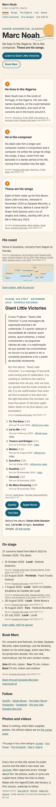
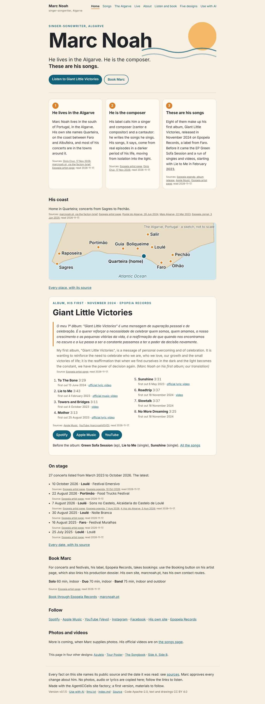
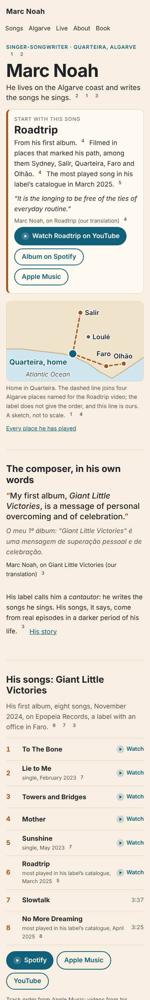
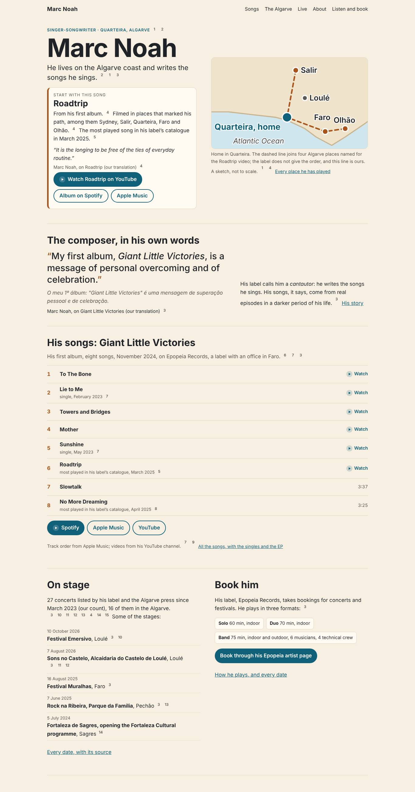

# Round 1

**Aim (conductor, 2026-11-17).** Make the story unmissable in the first screen, on a phone above all: he lives in the Algarve, he is the composer, he wrote these songs. The v0.1.5 home is clear but reads like a fact sheet: three equal cards, a map, a track list. Round one gives it a voice and a hierarchy: the songs lead, the place is felt, the sourcing stays but steps back.

Before: v0.1.5 (8c404a2), screenshots in `img/r1-before/`.

## What happened

| Step | Who | Output |
|---|---|---|
| Team, policies, workflow | conductor | `team/`, `scripts/role-scope.mjs`, `scripts/abp-check.mjs` (42040ae) |
| Critique of the live site | critic | [critic/NOTES.md](1/critic/NOTES.md): ten ranked notes (eeb4c6c) |
| Design proposal | designer | [design/PROPOSAL.md](1/design/PROPOSAL.md) and mock-ups: eight changes |
| Review of the design | reviewer | [review/DESIGN.md](1/review/DESIGN.md): all eight pass with conditions (c3a4a31) |
| Facts and copy | writer | [copy/COPY.md](1/copy/COPY.md): wording held to the sources (f3e23e0) |
| Build | developer | [build/NOTES.md](1/build/NOTES.md): f7529ac, e1fbb20, 094a9d4 |
| Release | conductor | 9ae455f, live as v0.1.12 |
| Review of the live site | reviewer | [review/LIVE.md](1/review/LIVE.md): pass, with follow-ups (da867ac) |

Dinis added /behind-the-scenes/ to the round at about 22:05 UTC (his words are in `team/WORKFLOW.md`).

## What changed on the site

1. The home opens with one line, "He lives on the Algarve coast and writes the songs he sings", and a Roadtrip panel with a button to watch it.
2. A close map of the central Algarve is the hero picture: Quarteira marked as home, a dashed route through the Algarve places in the Roadtrip video (the order is ours, and the caption says so).
3. The three equal cards gave way to the composer in his own words.
4. The songs come before the concerts.
5. Citations became small numbered markers (24 px) with one source list per page and the read date stated once.
6. The menu is about him: Songs, The Algarve, Live, About, Listen and book. The footer is about him too, with one quiet line about the site.
7. /songs/ opens with Roadtrip; /live/ opens with a block for programmers (formats, five stages, one booking button), and lists other appearances apart from concerts.
8. Facts tightened: "among them" for the Roadtrip places, "a label with an office in Faro", Santa Bárbara is in the Azores (Ribeira Grande), the count of concerts is marked as our own.
9. New: /behind-the-scenes/, generated at build time from `team/` and git log: the team and its policies, the flow, how the site started, every commit by round, and each round report.

## Before and after (home)

| | 390 px | 1366 px |
|---|---|---|
| Before (v0.1.5) |  |  |
| After (v0.1.15) |  |  |

More pairs: `img/r1-before/` and `1/review/after/` (songs, about, live, behind the scenes).

## Open after round 1

- Follow-ups from the live review: two inline links under 44 px, a heading skip on /sources/, small source links in the older designs, an unused colour that would fail as text. They go into round 2.
- Dinis, after seeing round 1 (about 22:30 UTC): the site "felt very basic"; Marc likes it "very professional, very slick". That is round 2's aim. His label's photos and embeds of his videos and songs are now cleared (about 22:45 and 22:55 UTC).
- For Marc, through Dinis: which photo leads; how to credit photographers; whether lyric lines may be quoted; songwriting credits beyond Roadtrip; whether he wants a Portuguese version.
