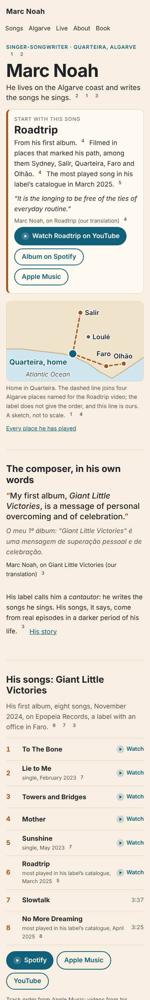
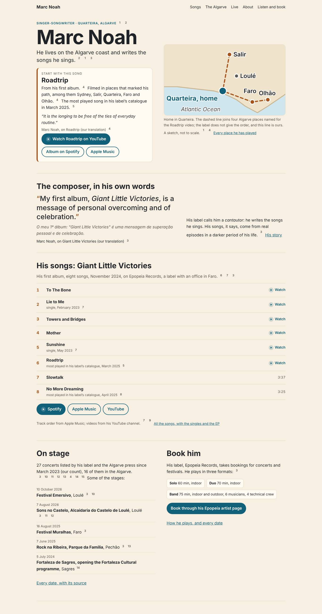
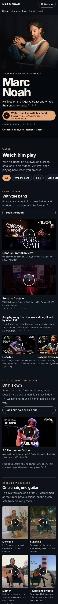
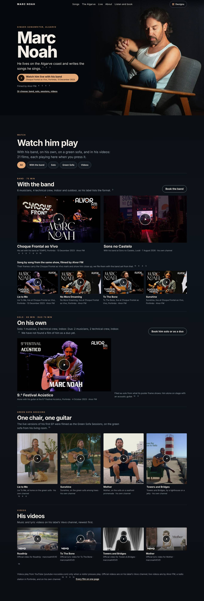

# Round 2

**Aim (conductor, 2026-11-17, from Dinis's words at about 22:30 and 22:45 UTC).** The first pass "felt very basic"; Marc "likes to be very professional, very sort of like, very slick". Round 2 makes the site look like a working artist's site: his label's photographs lead, his videos and songs play in the page (click to play, from YouTube and Spotify), and the type and layout are confident and dark rather than a fact sheet. The story stays the same: he lives in the Algarve, he is the composer, he wrote these songs. Sourcing stays complete but quiet.

Before: v0.1.12 and later (round 1), screenshots in `1/review/after/`.

## Dinis's words during the round

All recorded with times in `team/WORKFLOW.md`: the first pass "felt very basic", Marc likes it "very professional, very slick" (about 22:30 UTC); his label's photographs and embeds of his YouTube and Spotify releases cleared, with Marc's authorisation (22:45, 22:55), credited to Epopeia Records (23:00); a designs pop-up at the top of every page (23:05); short lyric lines cleared (23:10); agents renamed role.marc-noah@AgentiCCells.dinis (23:20); videos as the centrepiece: "Show Mark playing with the band ... Show him playing by himself. Show the whole type of services" (23:25).

## What happened

| Step | Who | Output |
|---|---|---|
| Research | writer | [copy/COPY.md](2/copy/COPY.md): his own site read through Arquivo.pt (web.archive.org cannot be reached from here), 21 videos with IDs, 14 more dated appearances, a biography, lyric lines, video formats (0515616, c425acd, 81f42c0) |
| Photographs | conductor | 13 from his label's artist page, resized and credited (`data/photos.mjs`) |
| Design proposal | designer | [design/PROPOSAL.md](2/design/PROPOSAL.md) and mock-ups: eight changes, videos first (7cec00c) |
| Review of the design | reviewer | [review/DESIGN.md](2/review/DESIGN.md): all pass, seven with conditions (0de85bf) |
| Build | developer | [build/NOTES.md](2/build/NOTES.md): af0fb47 |
| Release | conductor | 37f68c2, live as v0.1.27 |
| Review of the live site | reviewer | [review/LIVE.md](2/review/LIVE.md): pass with changes (0458e50) |

The writer corrected the brief on one point: the seven Alvor FM single-song films come from the band show (their frames carry the Choque Frontal mark), not a solo set. The site groups them with the band, marked as our inference, and asks Marc.

## What changed on the site

1. **Videos are the centrepiece.** "Watch him play": 21 films grouped by how you can book him: with the band (the Choque Frontal show at TEMPO, Portimão, and Sons no Castelo, Loulé), on his own (the 9.º Festival Acústico), the four Green Sofa Sessions filmed at home, among trees, on a seafront promenade and by a lighthouse, and his official videos. Filter chips, one player in a dialog that loads YouTube only when a visitor presses play, posters hosted here. Each song row links its films. A new /videos/ page lists all 21. Booking formats link to the films that show them; the duo line says plainly that we have not found a duo film.
2. **Designs pop-up** at the top of every page: a preview of each of the six designs, with its name and idea.
3. **A new Editorial design is the home**: his label's chair portrait full-bleed, his name, the one line, and "Watch him live with his band". The Coast stays as a design.
4. **A dark type and colour system** on the main pages, system fonts only; his lyric lines in serif italic, attributed.
5. **The album with a Spotify player** (loads on a press) beside the track list.
6. **Photographs** through /about/ and /songs/, and a gallery, credited to Epopeia Records.
7. **/live/ and booking**: a live photo band, the formats, and the contact his own site publishes (geral@epopeia-records.pt). Our concert count (40, 26 in the Algarve) is marked as ours.
8. **Credits**: every "no photos copied" line replaced by what is used and who it is credited to; the share card uses his photograph.

## Before and after (home)

| | 390 px | 1366 px |
|---|---|---|
| Before (v0.1.15, round 1) |  |  |
| After (v0.1.27) |  |  |

More: `2/review/after/` (songs, live, about, videos) and `2/build/shots/home-designs-open-*.jpg` (the designs pop-up).

## Open after round 2

- Developer follow-ups from the live review (Esc inside a playing film, posters loaded lazily, a heading skip on /videos/): fixed in a follow-up release (see `2/build/NOTES.md`).
- Nobody has played the Sons no Castelo film to check its orientation.
- Six Alvor FM single-song films have no date (YouTube refused the lookups).
- For Marc, through Dinis: which photograph leads; whether the band and solo grouping of the Alvor FM films is right; songwriting credits beyond Roadtrip; whether he wants a Portuguese version; whether marcnoah.pt is still his site.
