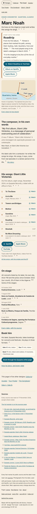
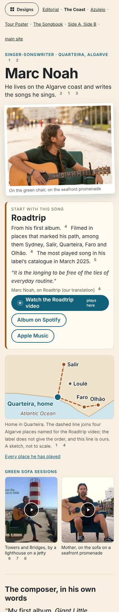
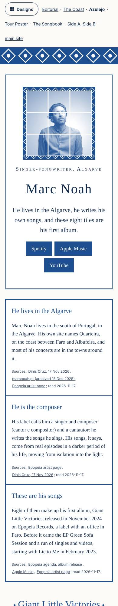
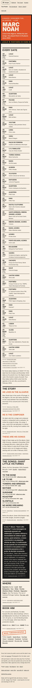
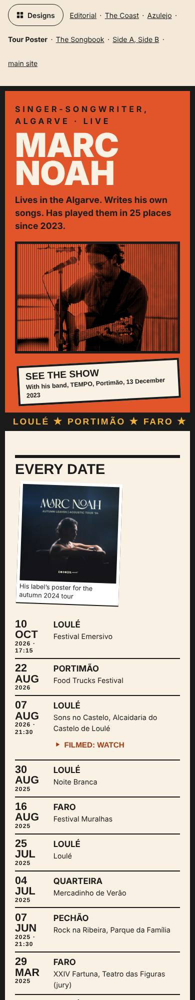
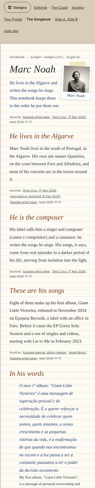
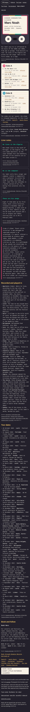
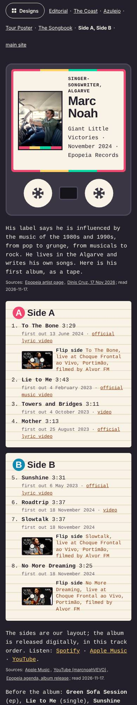

# Round 3

**Aim (conductor, 2026-11-17).** Dinis, about 23:55 UTC, in this session: "First design is amazing!! Are you adding some of those pics and video to the other designs? (They don't need to be video and image heavy than the first one)". Round 3 brings his label's photographs and a few of his films into the other five designs (The Coast, Azulejo, Tour Poster, The Songbook, Side A Side B), each in its own idiom and lighter than Editorial, with the same click-to-play player and credits.

Before: screenshots of the five designs in `img/r3-before/`.

## What happened

| Step | Who | Output |
|---|---|---|
| Design proposal | designer | [design/PROPOSAL.md](3/design/PROPOSAL.md) and mock-ups: two photographs and three films per design |
| Review of the design | reviewer | [review/DESIGN.md](3/review/DESIGN.md): all five pass with changes (d8644f8) |
| Build | developer | [build/NOTES.md](3/build/NOTES.md): f01d53b |
| Release | conductor | f01d53b, live as v0.1.33 |
| Review of the live site | reviewer | [review/LIVE.md](3/review/LIVE.md): pass (f14c51b) |

Conductor's decisions: black small text on the Tour Poster's orange (4.57:1 and above); three films for Azulejo rather than one per tile, as Dinis asked for designs lighter than Editorial.

## What changed on the site

Each of the five designs now has two of his label's photographs (one as its hero) and three of his films, in its own idiom, with the shared click-to-play player and the credits:

1. **The Coast:** the seafront green-chair photograph as a postcard beside the map (kept off the "Quarteira, home" marker, since the photograph's place is not sourced), Roadtrip playing in the page, and the Green Sofa Sessions by the sea and the lighthouse.
2. **Azulejo:** his black-and-white portrait in cobalt, set as nine tiles, the album cover as a tile, three song tiles that play their film.
3. **Tour Poster:** a halftone orange-and-black live photograph, a "See the show" stamp below it for the band set (Choque Frontal, Portimão, 13 December 2023), and "Filmed: watch" on the three date rows that have a film.
4. **The Songbook:** a taped-in polaroid of his portrait, and the three Green Sofa Sessions on the EP's song entries.
5. **Side A, Side B:** a cassette j-card with the Roadtrip car photograph, and three live films as the flip side.

The designs pop-up previews show the new looks.

## Before and after

| Design | Before (390 px) | After (390 px) |
|---|---|---|
| The Coast |  |  |
| Azulejo |  |  |
| Tour Poster |  |  |
| The Songbook |  |  |
| Side A, Side B |  |  |

Laptop widths: `3/review/after/*-1366.jpg`.

## Open after round 3

- Songbook track numbers are 2.04:1 (since round 1); Tour Poster at 1366 px leaves empty space beside the tour artwork; Esc inside a playing film (known, Close works).
- The questions for Marc are unchanged (see `team/HANDOVER.md`).
